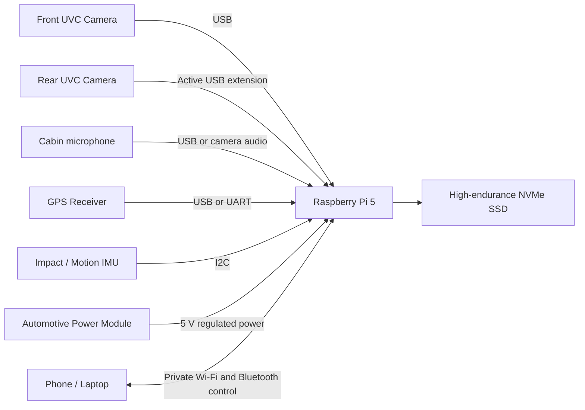

# Pi Local Dashcam

A fully local, privacy-first dashcam platform built around a single Raspberry Pi controller.

The initial design supports synchronized front and rear recording, local NVMe loop storage, protected incident clips, GPS/IMU metadata, and private phone access over Wi-Fi or Bluetooth. No cloud account or internet connection is required.

> **Status:** Early architecture and prototype planning.

## Project goals

- Use one central Raspberry Pi for all cameras and storage.
- Record front and rear video continuously.
- Keep video, audio, configuration, and metadata fully local.
- Store footage on a high-endurance NVMe SSD.
- Protect impact-triggered and manually selected clips from deletion.
- Provide a private local interface for preview, configuration, and downloads.
- Shut down safely when vehicle power is removed.
- Keep the camera transport reliable and wired.

## Important design decision

**Bluetooth is not used to carry video.**

Bluetooth remains useful for pairing, low-bandwidth controls, and initiating a private Wi-Fi connection. Continuous video should use wired USB for the first prototype, with Ethernet/PoE, GMSL2, or FPD-Link considered for later versions.

## Initial architecture



The front and rear cameras connect independently to the central controller. They are not daisy-chained through each other.

## Proposed prototype hardware

| Component | Initial recommendation |
|---|---|
| Controller | Raspberry Pi 5, 4 GB recommended; 2 GB minimum |
| Front camera | 1080p or 1440p UVC camera with H.264 and WDR |
| Rear camera | 1080p or 1440p UVC camera with H.264 and WDR |
| Rear connection | 3–5 m active USB extension or powered USB transport |
| Storage | 1–2 TB high-endurance NVMe SSD |
| NVMe interface | Raspberry Pi M.2 HAT+ or equivalent |
| Cooling | Active cooler and ventilated enclosure |
| Vehicle power | Fused automotive 12 V-to-5 V converter, 5 A class |
| Shutdown protection | Supercapacitor or short-duration UPS |
| Vehicle protection | ACC detection and low-voltage battery cutoff |
| Position/time | USB or UART GNSS receiver |
| Motion/impact | I2C accelerometer/IMU |
| Local access | Raspberry Pi Wi-Fi access point and Bluetooth pairing |

A realistic prototype budget is approximately **$400–$500**, depending on camera quality, storage size, enclosure, and power hardware. This is an engineering estimate rather than a vendor quote.

## Software direction

The proposed software stack is:

- Raspberry Pi OS Lite, 64-bit
- Python for orchestration and device management
- FFmpeg or GStreamer for capture and segmented recording
- `systemd` services for startup, recovery, and safe shutdown
- SQLite for clip metadata and health events
- FastAPI for the local management API
- A lightweight local web interface
- NetworkManager or `hostapd` for private Wi-Fi access-point mode

## Recording behavior

1. Start recording when ignition power is detected.
2. Record each camera into short, timestamped segments.
3. Store front and rear streams as separate files with aligned timestamps.
4. Delete the oldest unprotected segments when storage reaches its threshold.
5. Lock related front/rear segments when:
   - the IMU detects an impact,
   - the user presses an event button,
   - the phone interface requests protection.
6. Flush files and shut down safely after ignition power is removed.

## Suggested storage layout

```text
/data/dashcam/
├── continuous/
│   ├── front/
│   ├── rear/
│   └── audio/
├── protected/
│   ├── events/
│   └── manual/
├── metadata/
│   └── dashcam.db
└── logs/
```

## Repository structure

```text
pi-local-dashcam/
├── README.md
├── LICENSE
├── CONTRIBUTING.md
├── config/
│   └── default.yaml
├── docs/
│   ├── ARCHITECTURE.md
│   ├── HARDWARE.md
│   ├── POWER_AND_SAFETY.md
│   ├── PRIVACY_AND_SECURITY.md
│   ├── SOFTWARE.md
│   ├── TEST_PLAN.md
│   └── ROADMAP.md
├── scripts/
│   └── check_cameras.py
└── src/
    └── dashcam/
        └── __init__.py
```

## Documentation

- [Architecture](docs/ARCHITECTURE.md)
- [Hardware and provisional BOM](docs/HARDWARE.md)
- [Software design](docs/SOFTWARE.md)
- [Power and vehicle safety](docs/POWER_AND_SAFETY.md)
- [Privacy and security](docs/PRIVACY_AND_SECURITY.md)
- [Prototype test plan](docs/TEST_PLAN.md)
- [Roadmap](docs/ROADMAP.md)

## Early development setup

```bash
git clone <repository-url>
cd pi-local-dashcam

python3 -m venv .venv
source .venv/bin/activate
python -m pip install --upgrade pip

python scripts/check_cameras.py
```

The camera-check script only discovers Linux video devices. Capture and recording services will be added in a later milestone.

## Guiding principles

- **Local-first:** core functionality must not depend on internet access.
- **Fail safely:** sudden vehicle power loss must not corrupt the filesystem or active recordings.
- **Independent cameras:** one camera failure must not disable the other.
- **Recover automatically:** capture services should restart after transient failures.
- **Minimize distractions:** no driver-facing controls should require interaction while driving.
- **Preserve evidence:** protected clips must not be removed by ordinary loop-recording cleanup.


## Personal Noncommercial Project

Pi Local Dashcam is a personal, noncommercial software and hardware learning project.

It is developed solely for education, technical experimentation, research, open technical learning, and personal use. The repository documents my exploration of Raspberry Pi hardware, cameras, local storage, embedded software, networking, security, and related systems-engineering concepts.

This project is **not a business, startup, commercial product, paid service, commercial prototype, or product being developed for future sale**.

No goods or services are offered for sale through this repository. The project has no customers, commercial deployments, business model, sales activity, or commercialization roadmap.

Development milestones and future-work sections describe only technical experiments and personal learning goals.

The repository is provided for educational and noncommercial purposes under the applicable licenses. Commercial use is not permitted under those licenses. No commercial licensing program is offered through this repository.

## License

Please see LICENSE
