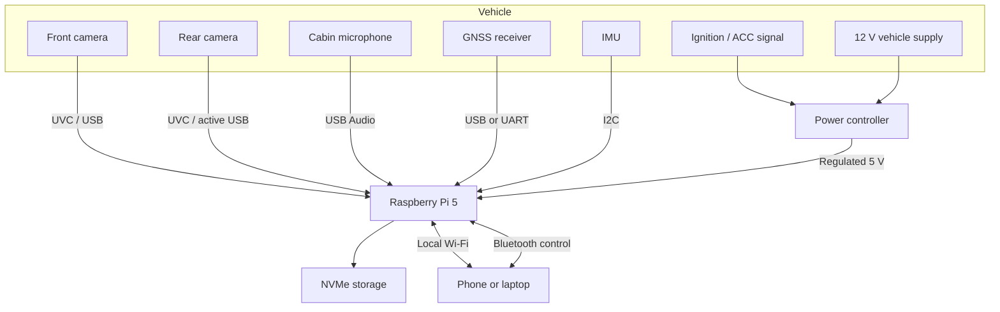
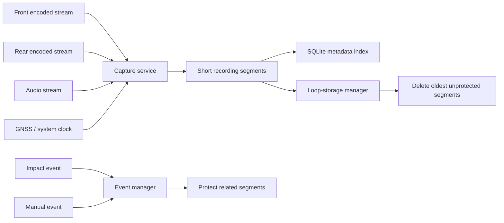

# System Architecture

## 1. Overview

The system uses a star topology centered on one Raspberry Pi 5. Every sensor, camera, storage device, and local user interface communicates with this controller.



## 2. Why one central controller

A single controller reduces:

- duplicated compute boards,
- duplicated storage,
- duplicated power regulation,
- software deployment complexity,
- synchronization problems,
- enclosure count,
- maintenance effort.

The cameras should contain only the sensor, lens, image processor, hardware encoder, and transport interface needed to deliver a compressed stream.

## 3. Camera transport

### Prototype: USB UVC cameras

The first prototype should use UVC-compatible USB cameras that can output H.264 or H.265. Camera-side compression reduces Raspberry Pi CPU load and USB bandwidth.

Requirements:

- 1080p30 minimum,
- hardware-compressed output,
- wide dynamic range,
- low-light capability,
- stable Linux UVC support,
- wide-angle lens,
- configurable exposure,
- timestamp consistency.

The rear camera should use an active USB extension or a powered USB transport appropriate for the cable length.

### Later alternatives

| Transport | Use case | Advantages | Limitations |
|---|---|---|---|
| USB UVC | Initial prototype | Low cost, easy Linux support | Cable length and connector robustness |
| Ethernet/PoE | Advanced prototype | One cable for data and power | Larger camera modules and switch hardware |
| Automotive Ethernet | Product direction | Vehicle-oriented networking | Higher integration effort |
| GMSL2 / FPD-Link | Automotive product | Long cable, low latency, robust synchronization | More expensive and specialized |
| Wi-Fi | Temporary experimentation | No long cable | Interference, latency, packet loss |
| Bluetooth | Controls only | Low-power pairing | Unsuitable for continuous video |

## 4. Recording pipeline



Recommended segment duration: one to five minutes. Short segments limit corruption when power is lost and simplify event protection.

## 5. Process boundaries

Suggested services:

- `dashcam-capture-front`
- `dashcam-capture-rear`
- `dashcam-audio`
- `dashcam-event-manager`
- `dashcam-storage-manager`
- `dashcam-device-health`
- `dashcam-local-api`
- `dashcam-power-monitor`

Each service should be restartable independently.

## 6. Failure behavior

| Failure | Expected behavior |
|---|---|
| Front camera disconnected | Rear recording continues; health event logged |
| Rear camera disconnected | Front recording continues; health event logged |
| SSD unavailable | Stop recording safely; raise local warning |
| Wi-Fi unavailable | Recording continues |
| Bluetooth unavailable | Recording continues |
| GPS unavailable | Use monotonic/system clock and flag metadata |
| Sudden ignition loss | Backup power completes current file and shuts down |
| Service crash | `systemd` restarts the affected service |
| Storage threshold reached | Delete oldest unprotected segments |

## 7. Time synchronization

All streams should use one controller clock. GNSS time may discipline the system clock when available. Front and rear filenames should share the same timestamp convention.

Example:

```text
2026-07-28T18-22-00Z_front.mp4
2026-07-28T18-22-00Z_rear.mp4
```

## 8. Local interfaces

Bluetooth should provide:

- initial pairing,
- basic device status,
- Wi-Fi credential exchange,
- event marking,
- low-bandwidth configuration.

Private Wi-Fi should provide:

- live preview,
- clip browsing,
- clip download,
- settings,
- diagnostics,
- local firmware update.

Core recording must remain independent of both interfaces.
