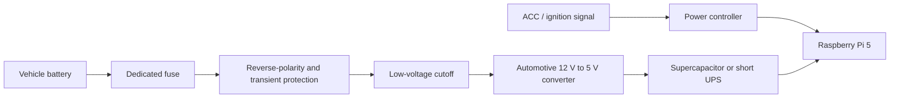

# Power and Vehicle Safety

## Warning

A development board must not be connected directly to a vehicle's nominal 12 V rail. Vehicle electrical systems can experience reverse polarity, cranking voltage drops, transients, and load-dump events.

This repository documents a prototype concept, not a certified automotive installation.

## Proposed power chain

## Required behaviors

### Ignition on

1. Detect ACC/ignition.
2. Power the central controller.
3. Boot the Raspberry Pi.
4. Verify storage and cameras.
5. Start recording.
6. Record a startup health event.

### Ignition off

1. Detect ACC loss.
2. Continue on short-duration backup power.
3. Stop accepting new ordinary recordings.
4. Finalize active video segments.
5. Flush metadata and filesystem buffers.
6. Request a clean operating-system shutdown.
7. Remove power after shutdown completes.

### Parking mode

Parking mode should be optional and configurable.

Possible modes:

- no recording while parked,
- low-frame-rate recording,
- motion-triggered recording,
- buffered event recording.

A low-voltage cutoff must prevent the dashcam from excessively discharging the vehicle battery.

## Safety requirements

- Use an inline fuse near the power source.
- Use correct wire gauge.
- Secure cables away from pedals, steering, airbags, seat rails, and sharp edges.
- Do not route camera cables across airbag deployment paths.
- Provide strain relief.
- Do not obstruct the driver's view.
- Ensure the enclosure cannot become a projectile.
- Validate heat generation during extended operation.
- Use professional installation when tapping permanent vehicle power.

## Filesystem protection

Recommended measures:

- store recordings on a separate NVMe data partition,
- use short segments,
- reserve free space,
- avoid repeated hard power cuts,
- consider a read-only root filesystem,
- run filesystem checks during controlled maintenance,
- maintain a shutdown marker to identify improper power loss.

## Power-state interface

The power controller should expose at least:

- ignition present,
- backup power active,
- low battery warning,
- shutdown requested,
- safe-to-remove-power signal.

A GPIO-based prototype may be used initially, but the interface should fail safely.
